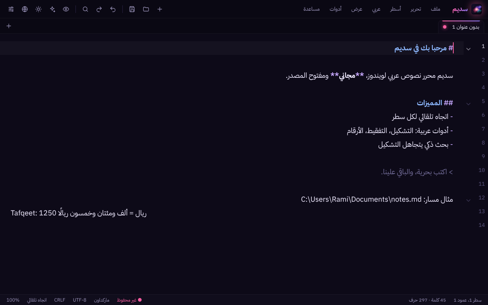
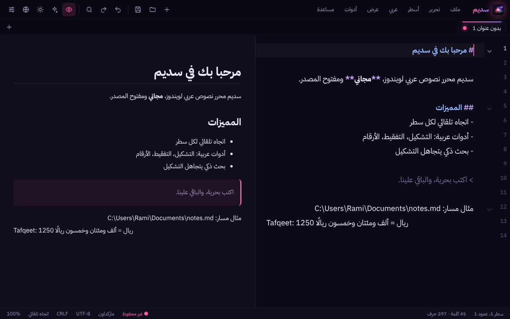
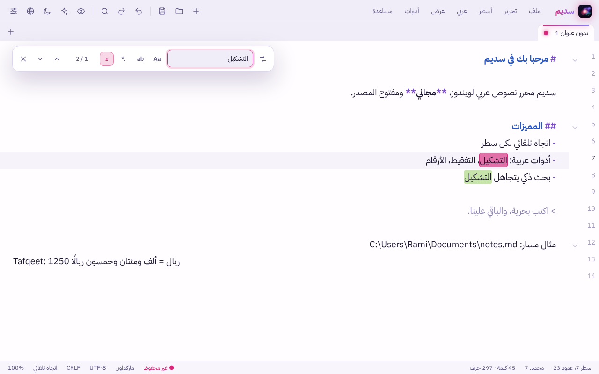
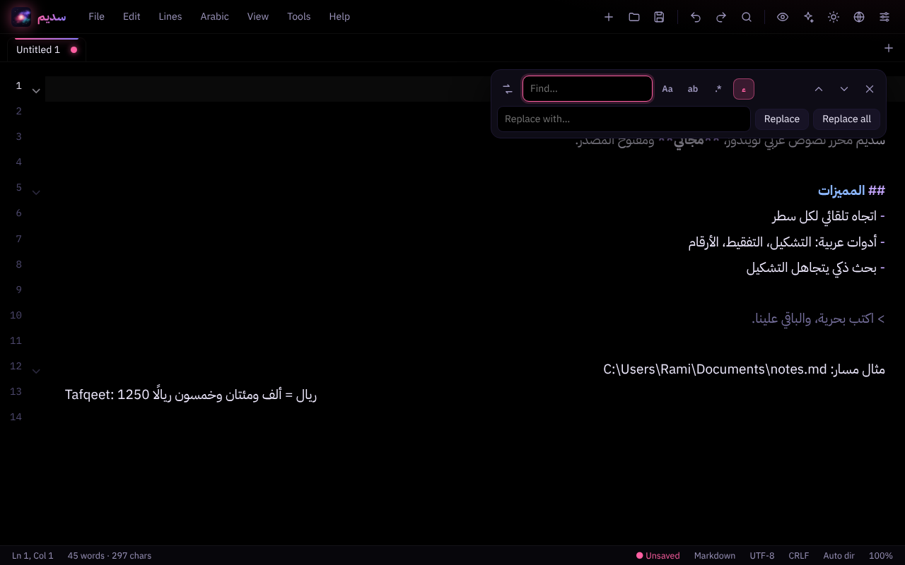

<div align="center">


# سديم · Sadeem

**محرر نصوص عربي لويندوز — مجاني ومفتوح المصدر**
**A free, open-source Arabic-first text editor for Windows**

[تحميل / Download](../../releases/latest) · [الرخصة / License](LICENSE) · من عائلة **فلك** · Part of the **Falak** family

</div>

<div align="center">



</div>

<details>
<summary>المزيد من اللقطات / More screenshots</summary>





</details>

---

## 🇸🇦 بالعربي

سديم محرر نصوص خفيف على طريقة «المفكرة»، لكنه مصمم للعربي من الأساس: اتجاه النص يتضبط تلقائيًا لكل سطر، وفيه أدوات عربية جاهزة، وشكل حديث بثيمات مستوحاة من السدم الفضائية.

### المميزات
- **عربي أولًا:** اتجاه تلقائي لكل سطر (العربي يمين والإنجليزي والمسارات يسار)، مع إمكانية تثبيت اتجاه واحد.
- **أدوات عربية:** حذف التشكيل والتطويل، توحيد الألف والياء، تحويل الأرقام (هندية ⇄ إنجليزية)، علامات الترقيم العربية، تصحيح الكتابة بلغة خاطئة (EN ⇄ عربي)، **تفقيط المبالغ**، وإحصائيات النص.
- **بحث واستبدال قوي:** يدعم التعبيرات النمطية، الكلمة الكاملة، وبحثًا عربيًا مرنًا يتجاهل التشكيل واختلاف الألف والياء.
- **تبويبات:** سحب لإعادة الترتيب، واستعادة الجلسة بعد الإغلاق (حتى النصوص غير المحفوظة).
- **ملفات آمنة:** حفظ ذري، اكتشاف التعديل الخارجي للملف، حفظ تلقائي اختياري.
- **ترميزات:** UTF-8، UTF-8 BOM، UTF-16، Windows-1256، ISO-8859-6، وغيرها، مع نهايات الأسطر CRLF / LF / CR.
- **أدوات للأسطر:** ترتيب، عكس، حذف المكرر والفارغ، ترقيم، تحريك وتكرار السطر، تحرير متعدد المؤشرات.
- **معاينة ماركداون** مباشرة، وتلوين الأكواد لعدة لغات.
- **تواريخ:** إدراج التاريخ الميلادي والهجري والوقت.
- **شكل رهيب:** ثيمات (سديم، أموليد، فجر، ورقي، حسب النظام) وألوان تمييز، وخطوط عربية مضمّنة، وواجهة عربية/إنجليزية، ووضع التركيز.
- **خصوصية:** يعمل بالكامل بدون إنترنت، بدون تتبع، وبدون إرسال أي بيانات.
- **ربط الملفات:** أيقونة خاصة لملفات سديم وخيار «فتح باستخدام».

### التثبيت
1. نزّل `Sadeem-Setup-1.0.0.exe` من صفحة [الإصدارات](../../releases/latest).
2. شغّله واتبع الخطوات.

> ⚠️ ويندوز قد يعرض تحذير **SmartScreen** لأن البرنامج غير موقّع رقميًا. اضغط «معلومات إضافية» ثم «تشغيل على أي حال». الكود كامل هنا وتقدر تبنيه بنفسك.

**المتطلبات:** ويندوز 10 أو 11 (يحتاج WebView2 وهو موجود افتراضيًا).

### الاختصارات المهمة
| الاختصار | الوظيفة |
|---|---|
| `Ctrl+N` / `Ctrl+O` / `Ctrl+S` | جديد / فتح / حفظ |
| `Ctrl+F` / `Ctrl+H` | بحث / استبدال |
| `Ctrl+G` | الانتقال إلى سطر |
| `Ctrl+Shift+P` | لوحة الأوامر |
| `Ctrl+Shift+V` | معاينة ماركداون |
| `Ctrl+Shift+X` | تبديل اتجاه النص |
| `F9` | وضع التركيز |
| `F1` | كل الاختصارات |

---

## 🇬🇧 English

Sadeem is a lightweight Notepad-style editor built Arabic-first: per-line automatic text direction, ready-made Arabic tools, and a modern look with nebula-inspired themes.

### Features
- **Arabic-first:** automatic direction per line (Arabic right-aligned, English and file paths left-aligned), or lock RTL/LTR.
- **Arabic tools:** remove diacritics and tatweel, normalize alef/yaa, convert digits (Hindi ⇄ Western), Arabic punctuation, wrong-keyboard-layout fixer (EN ⇄ AR), **amount-in-words (Tafqeet)**, and text statistics.
- **Powerful find & replace:** regex, whole word, and Arabic-aware fuzzy search that ignores diacritics and alef/yaa variants.
- **Tabs:** drag to reorder, full session restore (including unsaved text).
- **Safe file handling:** atomic saves, external-change detection, optional autosave.
- **Encodings:** UTF-8, UTF-8 BOM, UTF-16, Windows-1256, ISO-8859-6 and more; CRLF / LF / CR line endings.
- **Line tools:** sort, reverse, de-duplicate, number, move/duplicate lines, multi-cursor editing.
- **Live Markdown preview** and syntax highlighting for many languages.
- **Dates:** insert Gregorian, Hijri and time stamps.
- **Looks:** themes (Nebula, AMOLED, Dawn, Paper, System), accent colors, bundled Arabic fonts, Arabic/English UI, zen mode.
- **Private:** works fully offline, no telemetry, nothing is sent anywhere.
- **File association:** custom document icon and "Open with" support.

### Install
Download `Sadeem-Setup-1.0.0.exe` from the [Releases](../../releases/latest) page and run it.

> ⚠️ Windows SmartScreen may warn because the app isn't code-signed. Click **More info → Run anyway**. The full source is here and you can build it yourself.

**Requirements:** Windows 10/11 (WebView2 runtime, preinstalled).

---

## 🛠 Build from source

Requires Python 3.10+ and Node.js 18+.

```bat
:: run directly
pip install -r requirements.txt
run.bat

:: build the exe  ->  dist\Sadeem\Sadeem.exe
build.bat

:: build the installer: open installer.iss in Inno Setup and Compile
```

Edit the UI (sources in `ui-src/`, output in `ui/`):

```bash
cd ui-src
npm install
node build.mjs
```

Tests:

```bash
node --test ui-src/test/core.test.mjs
python -m unittest tests.test_backend
```

### Tech stack
Python · [pywebview](https://pywebview.flowrl.com/) (WebView2) · [CodeMirror 6](https://codemirror.net/) · [marked](https://marked.js.org/) · [DOMPurify](https://github.com/cure53/DOMPurify) · PyInstaller · Inno Setup

## 🤝 Contributing
Issues and pull requests are welcome. Found an Arabic-text edge case? Open an issue with a sample.

## 📄 License
Free and open source under the [MIT License](LICENSE). © 2026 **Rami Almalki**.
Bundled fonts (Amiri, Cairo, Tajawal, Noto Naskh Arabic, IBM Plex) are under the SIL Open Font License.

## 🔗 Follow
[@icrptd](https://x.com/icrptd) · Part of the **Falak (فلك)** family of tools.
